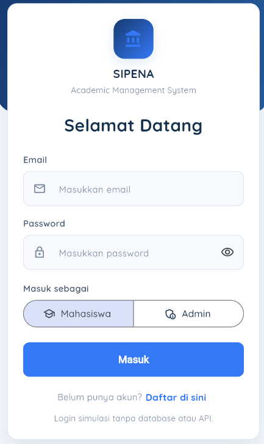
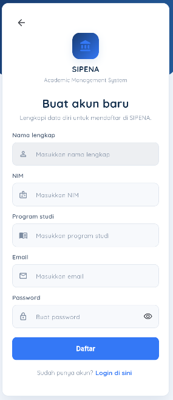
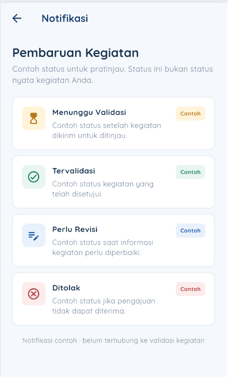
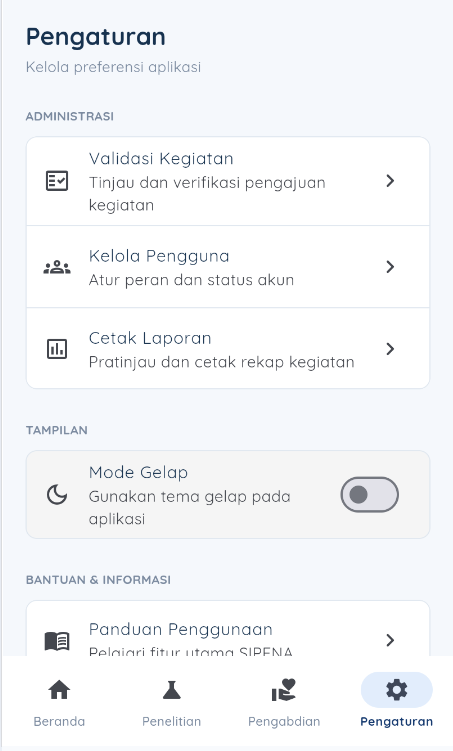
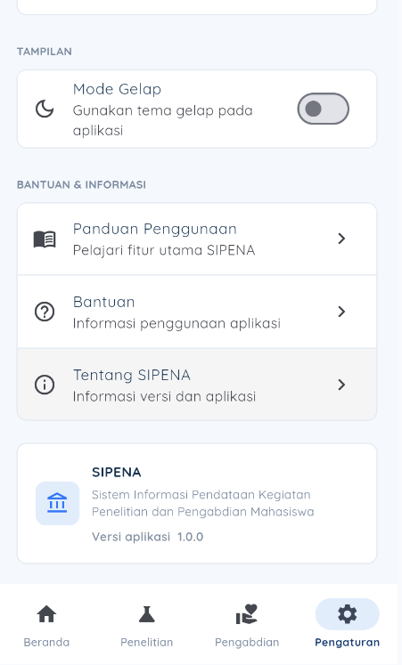

**Ringkasan Aplikasi**

SIPENA (Sistem Informasi Penelitian dan Pengabdian) merupakan aplikasi yang dikembangkan untuk membantu pengelolaan data kegiatan penelitian dan pengabdian mahasiswa. Aplikasi ini dibuat menggunakan Flutter berdasarkan rancangan antarmuka yang telah disusun dan ditujukan untuk dijalankan melalui browser.

SIPENA memiliki dua jenis pengguna, yaitu mahasiswa dan admin, dengan dashboard serta hak akses yang berbeda. Mahasiswa dapat mengelola data kegiatan penelitian dan pengabdian, mengunggah dokumentasi pendukung, memperbarui profil, serta menerima notifikasi terkait informasi atau status kegiatan yang dikelola.

Sementara itu, admin dapat memantau data kegiatan mahasiswa, melakukan validasi terhadap pengajuan kegiatan, menyetujui kegiatan, meminta revisi, atau menolak pengajuan sesuai hasil pemeriksaan. Admin juga memiliki akses untuk mengelola data pengguna dan melihat rekap laporan kegiatan.

Aplikasi ini dikembangkan untuk membantu proses pengelolaan dan pemantauan kegiatan penelitian serta pengabdian mahasiswa agar lebih terstruktur.

## Fitur Utama

- **Autentikasi Pengguna:** registrasi, login, dan logout.
- **Dashboard Mahasiswa:** menampilkan halaman utama untuk mengakses fitur mahasiswa.
- **Pengelolaan Data Kegiatan:** menambah, melihat, mengubah, dan menghapus data penelitian serta pengabdian.
- **Unggah Dokumentasi:** mengunggah berkas pendukung yang berkaitan dengan kegiatan.
- **Notifikasi Mahasiswa:** memberikan informasi mengenai status atau perkembangan kegiatan mahasiswa.
- **Dashboard Admin:** menampilkan ringkasan data pengguna dan kegiatan.
- **Validasi Kegiatan:** admin dapat memeriksa pengajuan kegiatan, menyetujui, meminta revisi, atau menolak pengajuan.
- **Kelola Pengguna:** melihat dan mengelola data pengguna sesuai hak akses.
- **Cetak Laporan:** menampilkan rekap kegiatan berdasarkan periode atau jenis kegiatan.
- **Profil Pengguna:** melihat dan memperbarui informasi profil.

## Screenshot Aplikasi SIPENA

### Halaman Login


### Halaman Register


### Beranda Mahasiswa


### Beranda Admin


### Daftar Penelitian


### Daftar Pengabdian


### Detail Penelitian


### Kegiatan Mahasiswa


### Kelola Pengguna


### Cetak Laporan


### Notifikasi


### Pengaturan




### Profil Mahasiswa


## Langkah Menjalankan Proyek

### Persyaratan Sistem

Sebelum menjalankan aplikasi SIPENA, pastikan perangkat telah memiliki:
- Flutter SDK.
- Visual Studio Code.
- Ekstensi Flutter dan Dart pada Visual Studio Code.
- Google Chrome.
- Git, jika proyek diunduh melalui GitHub.

### Langkah-Langkah Menjalankan Aplikasi

**1. Mengunduh Proyek**

Unduh atau clone repository SIPENA dari GitHub ke komputer. Jika menggunakan Git, jalankan perintah berikut pada terminal:

```bash
git clone (https://github.com/anitarahmawatiii/SIPENA_Flutter)
```


**2. Membuka Proyek**

Buka Visual Studio Code, pilih **File → Open Folder**, kemudian pilih folder proyek SIPENA yang telah diunduh.

**3. Membuka Terminal**

Buka terminal di Visual Studio Code melalui menu **Terminal → New Terminal**. Pastikan terminal berada di folder utama proyek yang memiliki file `pubspec.yaml`.

**4. Mengunduh Dependensi**

Jalankan perintah berikut untuk memasang dependensi yang dibutuhkan aplikasi:

```bash
flutter pub get
```

Tunggu hingga proses selesai.

**5. Memeriksa Perangkat Target**

Jalankan perintah berikut untuk memastikan Google Chrome terdeteksi sebagai perangkat target:

```bash
flutter devices
```

**6. Menjalankan Aplikasi**

Jalankan aplikasi SIPENA melalui browser menggunakan perintah:

```bash
flutter run -d chrome
```

**7. Mengakses Aplikasi**

Tunggu hingga proses kompilasi selesai. Aplikasi SIPENA akan terbuka di Google Chrome dan dapat digunakan sesuai fitur yang telah diimplementasikan.
